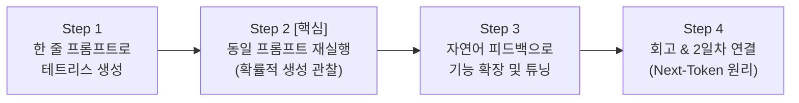

# 🎮 1일차 실습: 테트리스 만들기로 배우는 바이브코딩 & AI의 확률적 생성

> "**코드를 몰라도 지휘할 수 있다. 그리고 AI는 정답 자판기가 아니라 확률 기계다.**"

---

## 🎯 실습 목표

1. **설계자형 개발 체험**(바이브코딩 첫걸음):
   - 코드를 한 줄도 직접 타이핑하지 않고, 자연어 요구사항(프롬프트)만으로 브라우저에서 동작하는 완성도 높은 테트리스 게임을 제작합니다.
2. **AI의 확률적 생성**(Non-deterministic) **이해**:
   - 완전히 동일한 프롬프트를 다시 입력했을 때 **왜 항상 똑같은 코드가 나오지 않고 다른 구조와 디자인의 결과물이 생성되는지**를 직접 눈으로 확인합니다.
   - LLM이 검색 엔진처럼 정답을 복사해오는 '도깨비방망이'가 아니라, '**확률적으로 다음 단어**(토큰)**를 이어 붙이는 주사위**'임을 체감합니다.
3. **피드백 & 오케스트레이션 사이클 체득**:
   - 생성된 결과물을 검증하고, 마음에 들지 않는 점이나 추가하고 싶은 기능을 자연어로 피드백하여 개선하는 지휘자형 개발 프로세스를 익힙니다.

---

## 💡 왜 '테트리스 게임'인가요?

* **압도적인 학습 데이터**: 테트리스는 웹상에 HTML5/Canvas/JavaScript 오픈소스 코드가 가장 풍부하게 존재하는 게임 중 하나입니다. 복잡한 프롬프트 엔지니어링 없이도 한두 줄의 짧은 지시만으로 즉시 플레이 가능한 고품질 코드가 생성됩니다.
* **낮은 룰 설명 비용**: 남녀노소 누구나 블록 모양, 회전, 라인 삭제, 게임 오버 등 기본 룰을 이미 알고 있어 개발 룰을 구구절절 설명할 필요가 없습니다.
* **다양한 구현 방식**(확률성 교육에 최적):
  - 렌더링 방식: `HTML5 Canvas 2D API` vs `CSS Grid/Table DOM` 조작
  - 블록 회전 알고리즘: 회전 행렬 수학식 vs 하드코딩된 좌표 배열
  - 디자인: 레트로 8비트 아케이드 스타일 vs 세련된 네온 다크 테마

---

## 🧭 학습 진행 단계 (Step-by-Step)



---

### Step 1. 한 줄 프롬프트로 테트리스 만들기 (Aha-Moment)

1. **안티그래비티**(또는 AI 채팅창)를 열고 작업 디렉토리를 지정합니다.
2. 아래와 같이 명확하고 직관적인 단 한 줄의 프롬프트를 입력합니다.

```markdown
웹 브라우저에서 바로 플레이할 수 있는 테트리스 게임을 single-file (HTML, CSS, JS가 합쳐진 index.html)로 만들어줘. 방향키로 조작하고 스페이스바로 하드 드롭할 수 있어야 해.
```

3. 생성된 `index.html` 파일을 더블 클릭하거나 로컬 서버로 열어 웹 브라우저에서 직접 플레이해 봅니다.
4. **체크 포인트**:
   - 블록 이동(`←`, `→`) 및 회전(`↑`)이 정상 동작하는가?
   - 가로 한 줄이 채워졌을 때 라인이 삭제되고 점수가 오르는가?
   - 블록이 맨 위까지 쌓였을 때 GAME OVER 처리가 되는가?

> [!TIP]
> 코드를 전혀 읽지 못해도 상관없습니다. 브라우저에서 실행해보고 플레이가 되는지 확인하는 것 자체가 **설계자의 검증**(Verification) 과정입니다.

---

### Step 2. [핵심 실험] 주사위 던지기: 확률적 생성 체감하기

**이제 가장 중요한 실험을 진행합니다.**

1. 현재 대화창을 닫고, **완전히 새로운 대화창**(새 세션)을 엽니다.
2. Step 1에서 입력했던 **토씨 하나 틀리지 않은 동일한 프롬프트**를 그대로 복사하여 다시 입력합니다.
3. 새롭게 생성된 코드를 확인하고 브라우저에 띄워 첫 번째 결과물과 비교합니다.

```
[비교 관찰 포인트]
1. 화면 테마와 블록 색상이 같은가요?
2. 내부 코드를 열었을 때 Canvas 태그를 썼나요, 아니면 div/table 태그를 썼나요?
3. 점수판의 배치나 폰트 스타일이 동일한가요?
4. 옆자리 수강생의 결과물과 내 결과물은 어떻게 다른가요?
```


> [!IMPORTANT]
> **왜 똑같이 명령했는데 다른 결과가 나올까요?**  
> AI는 어딘가에 저장된 정답 파일 `tetris.html`을 복사해오는 것이 아닙니다.  
> 매 순간 "**앞에 나온 단어들 뒤에 올 가장 그럴듯한 다음 단어**"를 **확률적으로 계산**하여 주사위를 굴리듯 문장을 생성하기 때문입니다.  
> 이것이 바로 LLM의 **확률적/비결정론적 특성**(Non-deterministic)입니다.

---

### Step 3. 자연어 피드백으로 기능 확장하기 (오케스트레이션)

첫 번째 결과물에 만족하지 않고, 내가 원하는 요구사항을 추가하며 프로그램을 발전시킵니다.

#### 💡 피드백 프롬프트 예시

* **디자인 개선**:
  ```markdown
  게임 배경을 세련된 다크 모드로 변경해주고, 블록이 사이버펑크 네온 스타일로 빛나는 시각 효과를 추가해줘.
  ```
* **편의 기능 추가**:
  ```markdown
  1. 다음에 떨어질 블록을 미리 보여주는 'NEXT' 창을 우측에 추가해줘.
  2. 블록이 바닥 어디에 떨어질지 미리 반투명하게 가이드해주는 '고스트 피스(Ghost Piece)' 기능을 넣어줘.
  ```
* **난이도 및 점수 시스템**:
  ```markdown
  10줄을 깰 때마다 레벨이 1씩 오르고 블록이 떨어지는 속도가 15%씩 빨라지도록 난이도 시스템을 추가해줘.
  ```

#### 🛠️ 버그가 발생했다면?
블록이 벽을 뚫거나 회전 시 멈추는 현상이 발생하면, 당황하지 말고 브라우저의 현상이나 콘솔 에러를 그대로 AI에게 전달합니다:
```markdown
블록을 오른쪽 벽 끝에서 회전시키면 벽을 뚫고 화면 밖으로 나가는 버그가 있어. 벽에 닿았을 때는 안쪽으로 밀려나며 회전(Wall Kick)되도록 수정해줘.
```

---

### Step 4. 정리 및 2일차로의 연결

* **우리가 오늘 배운 것**:
  1. 개발자는 더 이상 문법을 외우고 코드를 타이핑하는 노동자가 아니라, **요구사항을 정의하고 결과를 검증하는 설계자**입니다.
  2. AI는 실시간으로 확률 주사위를 굴려 답을 만들어내는 **확률 기계**입니다.
* **내일**(2일차) **배울 내용**:
  - *"운동화 끈 묶는 방법을 알려줘" vs "끈 알려줘 운동화 방법을 묶는"*
  - AI가 왜 문맥과 순서에 민감한지, **다음 토큰 예측**(Next-Token Prediction)의 수학적 원리와 마크다운 문서화 기법을 깊이 있게 탐구합니다.
