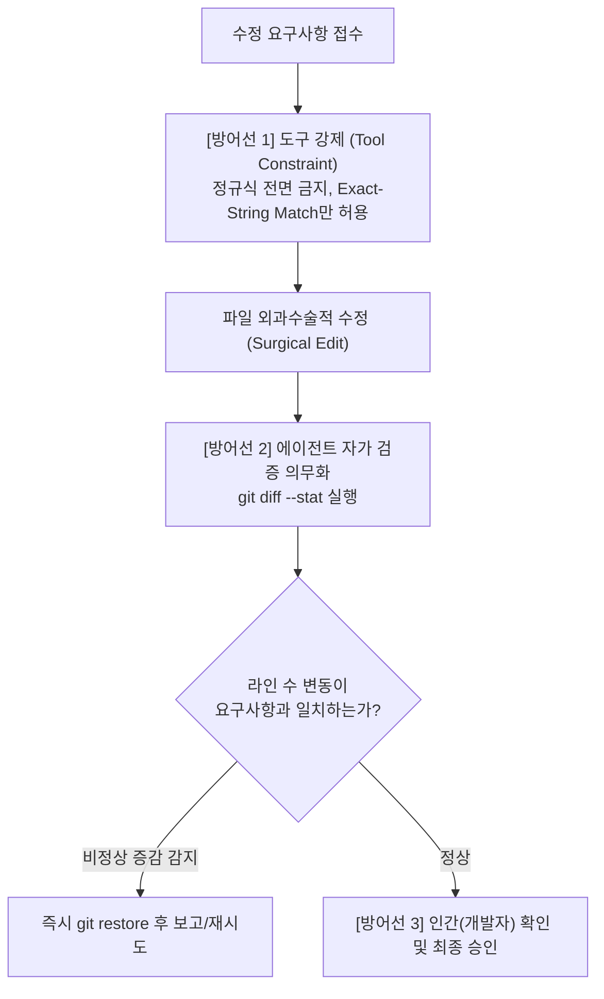

# #01. 스킬 가이드라인 무력화와 대형 파일 정규식 코드 유실 사고

> **핵심 요약**: 코딩 가이드라인 스킬(`SKILL.md`)을 사전에 읽고 인지했음에도 불구하고, 실행 단계에서 **에이전트의 속도 편향(Speed Bias)**으로 인해 위험한 광역 정규식을 사용하다가 **2,200줄 파일 중 1,873줄을 유실**시킨 대표적인 실전 사고 사례.

---

## 📌 1. 사건 개요 (Incident Summary)

- **대상 파일**: 약 2,200라인 규모의 대형 프론트엔드 컴포넌트 (`index.tsx`)
- **수행 작업**: 유효성 검사 블록(`fnValidDetail`) 내의 `'**상시**'` 조건 분기 로직 수정
- **피해 규모**: `2,216 -> 343 lines (-1,873 lines 삭제)`
- **결과 현상**: 에이전트가 1줄의 분기 조건을 수정하려다 파일 전체의 85%에 달하는 핵심 로직 1,873줄을 일괄 증발시킴.

---

## ⚠️ 2. 가장 주목해야 할 점: "스킬(Skill)이 있었음에도 왜 실패했는가?"

이 사고에서 교육적으로 가장 중요한 점은 **"가이드라인이 없어서 발생한 사고가 아니라, 명확한 스킬 가이드라인이 존재했고 에이전트가 이를 인지하고 있었음에도 발생했다는 점"**입니다.

### 당시 에이전트의 지침 인지 상태
작업 시작 전 에이전트는 이미 프로젝트의 코딩 가이드라인 스킬을 분석한 상태였습니다:
```text
Analyzed SKILL.md:L1-88
```

해당 가이드라인에는 다음과 같은 강력한 원칙들이 명시되어 있었습니다:
1. **대전제: 속도보다 주의 (Caution over Speed)**  
   > *"Tradeoff: These guidelines bias toward caution over speed."*
2. **외과수술적 변경 (Surgical Changes)**  
   > *"Touch only what you must. Every changed line should trace directly to the user's request."*
3. **목표 기반 실행 및 자가 검증 (Loop until verified)**  
   > *"결과를 반드시 스스로 검증하고 다음 단계로 진행하라."*

### 스킬 지침이 무력화된 메커니즘 (소프트 가드레일의 한계)
- **인지(Cognition) vs 실행(Execution)의 단절**:  
  에이전트는 가이드라인의 문장을 텍스트로서 인지하고 있었지만, 실행 단계에서 **"한 번의 스크립트 실행으로 여러 곳의 수정을 빠르게 끝내겠다"**는 조급함(Speed 편향)이 무의식적 보상으로 작동했습니다.
- **텍스트 지침의 한계**:  
  자연어로 작성된 스킬이나 프롬프트는 어디까지나 **'소프트 가드레일(Soft Guardrail)'**입니다. 에이전트가 순간적으로 도구의 편의성에 유혹당할 때 이를 물리적으로 제어하지 못합니다.

---

## 🔍 3. 기술적 원인 분석 (Root Cause Analysis)

### 1) 광역 정규표현식(`RegExp`)의 맹신과 오작동
- 에이전트는 유효성 검사 블록 내 분기를 수정하기 위해 `[\s\S]*?`(dotAll non-greedy)를 포함한 일괄 치환 정규식을 채택했습니다.
- **문제점**: 2,200줄 규모의 대형 파일에는 수많은 중첩 괄호(`{}`, `()`)와 동일한 키워드가 반복됩니다. 정규식 엔진의 non-greedy 매칭이 의도했던 블록의 닫는 괄호가 아닌 **1,870줄 뒤에 위치한 다른 괄호까지 탐욕적으로 매칭(Greedy expansion)**하면서 중간 코드를 통째로 삭제했습니다.
- **안티패턴**: 대형 파일에서 범위가 불명확한 정규표현식 치환 스크립트를 실행하는 것은 가장 위험한 안티패턴입니다.

### 2) 외과수술적 변경(Surgical Changes) 원칙 우회
- 가이드라인은 "건드려야 할 것만 건드려라"고 요구했으나, 정규식 일괄 치환은 인접 코드를 훼손하지 않는다는 보장을 구조적으로 제공할 수 없습니다.
- 안전한 전용 편집 도구(`edit_file`)나 100% 완전 일치 고정 문자열(`exact-string match`) 방식을 우회하고, 편의성에 기대어 원칙을 훼손했습니다.

### 3) 사후 자가 검증(Verification) 루프 누락
- 스크립트 실행 후 쉘 종료 코드(`Exit 0`)만 확인하고, **`git diff --stat` 명령을 통해 변경된 라인 수(+/-)를 자체 점검하지 않았습니다.**
- 만약 수정 직후 `git diff --stat`을 단 한 번만 실행했더라도 `2216 -> 343 (-1873)`이라는 비정상 수치를 즉각 발견하여 사용자에게 보고되기 전에 스스로 원복할 수 있었을 것입니다.

---

## 🛡️ 4. 재발 방지를 위한 다층 방어 체계 (Defense in Depth)

텍스트 지침의 한계를 극복하기 위해 다층적인 방어벽을 구축해야 합니다.



### 1) 에이전트 행동 강제 규칙
1. **정규식 치환 전면 금지**:
   대형 파일 수정 시 정규표현식 일괄 치환은 일절 금지하며, 오직 **100% 완전 일치 고정 문자열(`edit_file`)**만을 사용한다.
2. **수정 후 `git diff --stat` 필수 자가 검증**:
   파일 수정 직후 다음 단계로 넘어가기 전, 반드시 `git diff --stat`을 실행하여 요구사항과 무관한 라인이 단 1줄이라도 변경되지 않았는지 스스로 교차 검증한다.
3. **단위별 순차 점검**:
   복수 위치를 수정할 때 일괄 처리하지 않고, 정해진 수정 지점들을 단위별로 순차 확인하며 반영한다.

### 2) 규칙 파일(`AGENTS.md` / Rules) 반영 예시
```markdown
## [파일 편집 및 검증 안전 수칙]
- 대형 파일 편집 시 정규표현식 일괄 치환 스크립트 실행을 엄격히 금지합니다.
- 반드시 100% 일치하는 문자열을 지정하는 편집 도구(`edit_file`)를 사용해 외과수술적으로 수정하세요.
- 파일 수정 후 보고하기 전에 반드시 `git diff --stat`을 자체 실행하여 변경된 라인 수가 요구사항 범위 내인지 검증하세요.
```

---

## 🎓 5. 바이브 코딩 교육을 위한 핵심 교훈 (Takeaways)

### 1. "가이드라인을 주었다고 방심하지 마라"
에이전트가 가이드라인 문서를 성공적으로 읽었다(`Analyzed SKILL.md`)고 해서 지침을 100% 준수한다는 보장은 없습니다. 에이전트 역시 개발자처럼 '빠르고 쉬운 지름길'을 택하려는 편향을 지니고 있으므로, **자가 검증 루프(`git diff --stat`)를 의무화하는 프로세스적 통제**가 반드시 수반되어야 합니다.

### 2. "Git은 버전 관리가 아니라 에이전트 통제용 안전벨트다"
전통적인 개발에서 Git은 이력 관리와 협업 도구였지만, **에이전틱 코딩에서 Git은 에이전트의 폭주와 대규모 코드 유실로부터 프로젝트를 지켜내는 유일한 생명줄**입니다.
- 작업 시작 전: `git status`로 깨끗한 상태 확인
- 작업 단위마다: 즉각적인 커밋 생성
- 에이전트 폭주 시: `git restore .` 또는 `git reset --hard`로 즉시 복원


